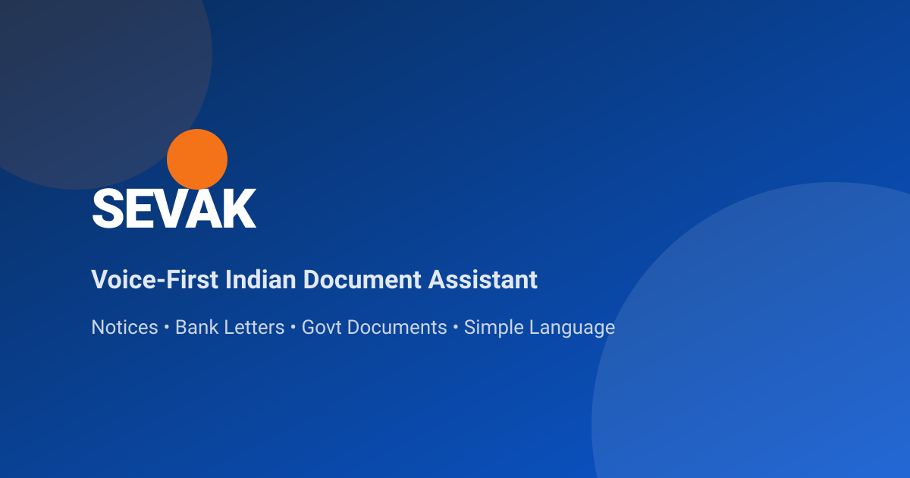
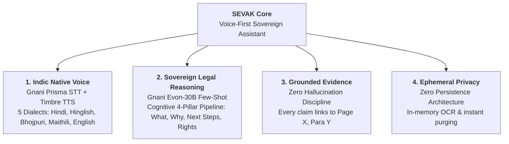

# 📖 About SEVAK — Voice-First Indian Document Assistant

### *Samjhega. Batayega. Raasta dikhayega.*
**India's Sovereign Voice-First AI Legal Notice & Official Document Interpreter**

---

## 🎯 The Mission

Every year, over **4.2 Crore official notices, court summons, tax demands, and bank warnings** are delivered to Indian households. The overwhelming majority are written in dense, archaic English legalese—riddled with statutory citations (Section 148, Section 138 NI Act, SARFAESI 13(2)), strict countdown deadlines, and intimidating penalty clauses.

For over 90% of Indian citizens, receiving such a document creates visceral anxiety:
- *"Am I going to jail?"*
- *"Will the police come to my house?"*
- *"Is my bank account frozen?"*
- *"How much do I actually have to pay, and by when?"*

Because there is no trusted, accessible intermediate layer between confusing paperwork and expensive lawyers, everyday citizens either:
1. **Panic and pay predatory fees** (₹5,000–₹15,000) just to have an advocate read what the letter says.
2. **Ignore the notice out of fear**, resulting in non-bailable warrants, bank account freezes, or heavy compounding penalties.

**SEVAK** was engineered to eliminate this barrier forever.

By providing **sovereign, voice-first comprehension in native Indian languages**, SEVAK empowers citizens to upload any legal or official document, hear an empathetic, plain-language explanation, view an instant urgency triage score, receive exactly 3 actionable next steps, and ask follow-up questions using their voice—grounded 100% in the source document.

---

## 🏛️ Guiding Motto

> **"Samjhega. Batayega. Raasta dikhayega."**  
> *(It will understand. It will explain. It will guide the path.)*

SEVAK does not replace a lawyer; it removes the fear, clarifies the facts, and equips the citizen with truth and verified next steps.

---

## 💡 The 4 Pillars of SEVAK

### 1. Indic Native Voice Accessibility

Language and literacy should never determine whether a citizen understands their legal rights. SEVAK communicates through:
- **Speech-to-Text (STT):** Powered by **Gnani Prisma STT**, calibrated for 98% dialect accuracy across mixed Hindi, Hinglish, Bhojpuri, Maithili, and English.
- **Text-to-Speech (TTS):** Powered by **Gnani Timbre TTS**, speaking back in natural, regional tones with conversational warmth instead of robotic monotone.

### 2. Sovereign Legal Reasoning (Gnani Evon-30B)

Rather than outputting generic summaries, SEVAK structures document analysis through a strict 4-pillar legal framework:
- **What:** The plain-language core allegation or demand.
- **Why:** The statutory basis and issuing authority reasons.
- **Next Steps:** Exactly 3 prioritized, non-legalistic action steps.
- **Rights & Protections:** Statutory defense rights, plus clear disclaimers that SEVAK does not provide legal representation.

### 3. Grounded Evidence Discipline ("Show Me Where")

Hallucinations in legal contexts are catastrophic. SEVAK enforces a **zero-hallucination contract**:
- Every factual claim, deadline, and monetary figure is cited with an exact `Page X, Paragraph Y` reference.
- Citizens can click or ask *"Show me where it says this"*, and SEVAK highlights the precise text in the original document.

### 4. Ephemeral Privacy Shield

Legal notices contain sensitive personal data (PAN, Aadhaar numbers, vehicle registrations, dispute details, financial amounts).
- All document OCR, text extraction, and voice processing happen **exclusively in RAM**.
- No user documents, text extractions, or voice recordings are permanently stored on disk or sold to third parties.

---

## 👥 Development Team

SEVAK was built with pride for the **Great Indian AI Internship Challenge (Gnani AI)** by:

| Engineer | Focus & Responsibilities | Key Contributions |
|---|---|---|
| **Divyanshu Raj** | **AI/ML Architecture & Frontend Engineering** | Indic Prompt Design, Evon-30B Few-Shot Reasoning, React 19 UI, Voice Interaction Flows |
| **Kamal** | **Backend Architecture & Infrastructure** | FastAPI Gateway, OCR Pipeline, Grounding Citation Engine, Ephemeral Memory Security |

---

## ⚖️ Ethical AI & Legal Disclaimer

- **Information Assistant, Not an Advocate:** SEVAK provides plain-language document interpretation and organizational guidance. It does not provide legal representation or create an attorney-client relationship.
- **Urgency Escalation:** For notices with statutory urgency (RED status, such as warrants or property seizure notices under SARFAESI), SEVAK explicitly advises the citizen to consult an advocate or visit their nearest District Legal Services Authority (DLSA).
- **Sovereign & Open Source:** Released under the [MIT License](LICENSE) to promote digital inclusion across India.
