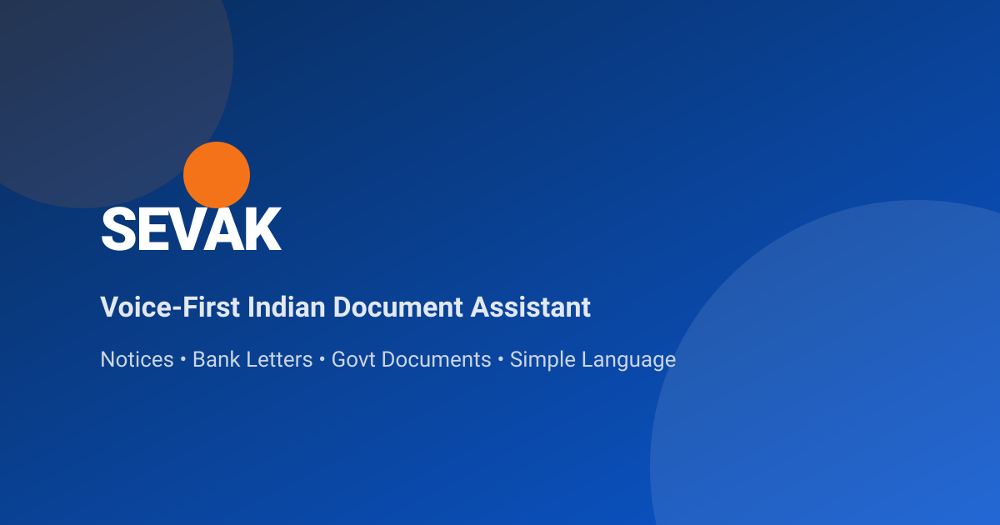
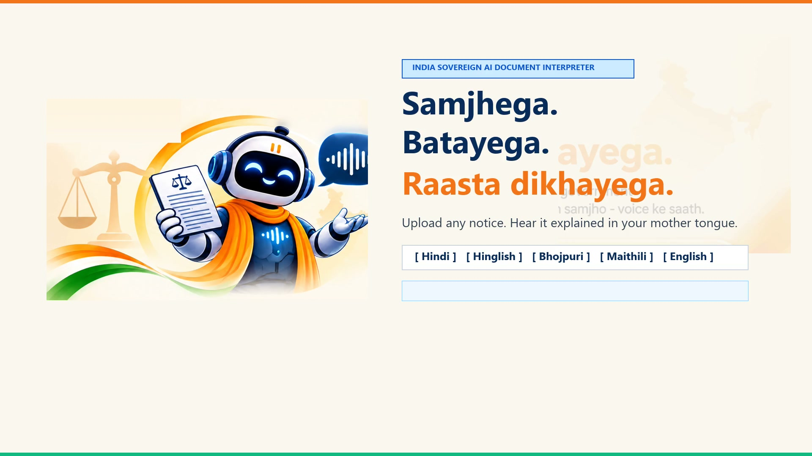

# SEVAK — Voice-First Indian Document Assistant 🇮🇳

<div align="center">



### *Samjhega. Batayega. Raasta dikhayega.*
**India's Sovereign Voice-First AI Legal Notice & Official Document Interpreter**

[](LICENSE)
[](https://fastapi.tiangolo.com)
[](https://react.dev)
[](https://www.typescriptlang.org)
[](https://www.python.org)
[](https://gnani.ai)
[](#-great-indian-ai-internship-challenge)
[](public/assets/video/brag.mp4)

[About](#-about-sevak) • [Demo Video](#-55-second-intro-video) • [Key Features](#-key-features) • [The Problem](#-the-problem-fear-in-the-mailbox) • [Explainability Pipeline](#-the-6-pillar-explainability-pipeline) • [Architecture](#-sovereign-indic-architecture) • [Security & Privacy](#-security--zero-exposure-credential-architecture) • [Development Team](#-development-team) • [Quickstart](#-quickstart)

</div>

---

## 🎬 55-Second Intro Video

<div align="center">

[](public/assets/video/brag.mp4)

**▶️ [Click here to watch the 55-Second Demo Video](public/assets/video/brag.mp4)**  
*From Intimidating Legal Notices to Plain Language & Spoken Action Steps in 5 Indian Languages*

| Timestamp | Story Beat | What You See |
|:---:|---|---|
| **0:00** | **The Crisis** | 4.2 Crore annual notices, archaic English legalese, and citizen panic |
| **0:08** | **Meet SEVAK** | Sovereign voice-first assistant with 5 Indic dialects & ephemeral privacy |
| **0:17** | **Case Study 1** | Delhi Traffic Police E-Challan: 🔴 High Urgency triage & 3 verified steps |
| **0:27** | **Case Study 2** | SBI Re-KYC Update: 🟡 Medium Urgency & live neural voice synthesis |
| **0:37** | **Explainability** | 4-Pillar framework (What, Why, Next Steps, Rights) & Gnani Indic AI stack |
| **0:46** | **Team Credits** | **Divyanshu Raj** (AI/ML & Frontend) • **Kamal** (Backend & Infrastructure) |

</div>

---

## 📖 About SEVAK

> **"Samjhega. Batayega. Raasta dikhayega."**  
> *(Understands. Explains. Guides the way.)*

**SEVAK** is India's sovereign, voice-first AI assistant built to decode confusing, high-stress legal notices, court summons, tax demands, and bank letters for everyday citizens.

Over **4.2 Crore official notices and summons** are served across India every year. Almost all are drafted in archaic, intimidating colonial-era English legalese—loaded with statutory citations (Section 148, SARFAESI 13(2), NI Act 138), hidden deadlines, and veiled threat language. For 90%+ of Indian citizens, receiving such a document triggers visceral panic:

- *Am I going to jail?*
- *Is my bank account frozen?*
- *How much do I actually owe, and by what deadline?*
- *What is my immediate, concrete next step?*

Because citizens lack an accessible, non-threatening bridge to understand these papers, they often pay **₹5,000–₹15,000 in predatory advocate panic fees** just to have someone read the notice—or worse, ignore it out of fear until compounding penalties or warrants are issued.

**SEVAK** bridges this divide through five core pillars:

1. 🎙️ **Voice-First Indic Interaction:** Ingests notices via camera or PDF and provides spoken explanations in **Hinglish, Hindi, Bhojpuri, Maithili, and English** powered by **Gnani Prisma STT** and **Timbre TTS**.
2. 🧠 **Sovereign Legal Reasoning:** Powered by **Gnani Evon-30B**, few-shot calibrated on Indian procedural laws, tax rules, and statutory timelines.
3. ⚖️ **Instant Severity Triage:** High-visibility **Green / Yellow / Red** alert badges with statutory countdown timers and penalty warnings.
4. ✅ **Exactly 3 Next Steps:** A prioritized, jargon-free roadmap of immediate actions.
5. 📌 **100% Grounded Citations ("Show Me Where"):** Zero hallucination—every single statement links directly to `Page X, Paragraph Y` in the scanned notice.
6. 🛡️ **Ephemeral Privacy Shield:** Strictly in-memory processing. Documents and voice recordings are never permanently stored, monetized, or retained.

👉 *For the complete origin story, design philosophy, and ethical framework, read [ABOUT.md](ABOUT.md).*

---

## 🌟 Overview

Over **4.2 Crore official notices and summons** are served to Indian citizens every year. Almost all are drafted in archaic, intimidating English legalese—packed with hidden deadlines, confusing statutory citations (e.g., Section 148, SARFAESI 13(2), NI Act 138), and high financial penalties.

For 99% of Indians, the real problem is not receiving the letter—it is the **paralyzing confusion and fear**:
- *Am I going to jail?*
- *Is my bank account frozen?*
- *How much do I actually owe, and by when?*
- *What is my immediate next step?*

**SEVAK** bridges this gap. Citizens simply upload a photo or PDF of any official document, hear an empathetic voice explanation in their mother tongue (**Hinglish, Hindi, Bhojpuri, Maithili, or English**), see an instant **urgency triage meter**, receive **exactly 3 concrete next steps**, and ask follow-up questions using their voice—with **100% verifiable citations** grounded in the original text.

---

## 🚀 Key Features

| Capability | How SEVAK Delivers It |
|---|---|
| 📄 **One-Tap Ingestion** | Upload `.pdf`, `.png`, `.jpg`, `.jpeg` of notices, summons, challans, or bank letters. |
| 🎙️ **Voice-First Q&A** | Ask follow-up questions via microphone in your natural dialect using **Gnani Prisma STT** (98% Indic dialect accuracy). |
| 🧠 **Sovereign Legal Reasoning** | Powered by **Gnani Evon-30B** few-shot trained on Indian departmental procedures and statutory codes. |
| 🗣️ **Natural Spoken Answers** | Real-time neural speech synthesis using **Gnani Timbre TTS** in regional tones. |
| ⚖️ **Instant Severity Triage** | High-contrast **Green / Yellow / Red** alert badges with countdown timers and statutory penalty flags. |
| ✅ **Exactly 3 Next Steps** | Actionable, prioritized, and jargon-free roadmap for the citizen. |
| 📌 **Grounded Evidence ("Show Me Where")** | Zero hallucinations: every claim links to an exact `Page X, Paragraph Y` in the original notice. |
| 🛡️ **Ephemeral Privacy Shield** | In-memory processing only: documents and voice recordings are never permanently stored or monetized. |
| 🌐 **Multilingual Indic Matrix** | Full support for Hindi, Hinglish, English, Bhojpuri, and Maithili. |

---

## 🎯 The Problem: Fear in the Mailbox

```
     TRADITIONAL EXPERIENCE                              THE SEVAK EXPERIENCE
┌───────────────────────────────┐                  ┌───────────────────────────────┐
│  Intimidating Court Summons   │                  │  Upload Notice / Snap Photo   │
│  Dense English legalese       │                  │  Instant In-Memory OCR        │
│  Panic, anxiety, no clue      │   ──────────►    │  Listen to summary in Hindi   │
│  Missed statutory deadlines   │                  │  Clear Green / Red Urgency    │
│  ₹10,000+ paid to advocates   │                  │  3 Prioritized Action Steps   │
│  Unverified internet advice   │                  │  Verifiable Page Citations    │
└───────────────────────────────┘                  └───────────────────────────────┘
```

---

## 💡 The 6-Pillar Explainability Pipeline

Instead of a generic AI summary, SEVAK structures every document through a strict cognitive framework:

```
    [ WHAT ]        → What does this document actually allege or demand in simple language?
       │
    [ WHY ]         → Why did the issuing authority send it, and what are the legal grounds?
       │
  [ NEXT STEPS ]    → Exactly 3 practical, prioritized actions the citizen must take.
       │
   [ RIGHTS ]       → Citizen protections, reply rights, and the mandatory "Not a Lawyer" safety notice.
       │
  [ DEADLINES ]     → Exact dates, calculation of remaining days, and statutory default penalties.
       │
   [ SOURCE ]       → Direct Page & Paragraph citation linking every statement to original evidence.
```

---

## 🏛️ Supported Indian Notice Archetypes

SEVAK includes pre-configured, tested grounding prompts for the four most frequent high-stress legal notice categories in India:

```
1. 🏦 Income Tax Notices (Section 148 / 143(2) / 142(1))
   • Severity: HIGH (RED)
   • Statutory Window: 30 days from date of service
   • Key Guidance: Logging into incometax.gov.in with PAN, filing Section 148A response, consulting CA.

2. 🚦 Traffic Police Notices (Motor Vehicles Act E-Challans)
   • Severity: WARNING (YELLOW)
   • Statutory Window: 60 days before virtual court escalation
   • Key Guidance: Verifying vehicle RC & offense photo on parivahan.gov.in, paying online or contesting.

3. 🏠 Rent Eviction Notices (State Rent Control Acts)
   • Severity: WARNING (YELLOW — Pre-litigation)
   • Statutory Window: 30 to 90 days statutory notice period
   • Key Guidance: Gathering rent receipts/bank records, issuing written reply, seeking legal-aid clinic if needed.

4. 💳 Bank Loan Default Notices (SARFAESI Act Section 13(2))
   • Severity: HIGH (RED — Property Seizure Risk)
   • Statutory Window: 60 days statutory cure period before Section 13(4) possession
   • Key Guidance: Direct branch manager representation, restructuring request, DRT counsel.
```

---

## 🧠 Sovereign Indic Architecture

```text
                                 CITIZEN
                                    │
                     ┌──────────────┴──────────────┐
                     │                             │
               [ DOCUMENT ]                  [ VOICE QUERY ]
             PDF / Scan / Photo           Spoken in Mother Tongue
                     │                             │
                     ▼                             ▼
             FRONTEND CLIENT               FRONTEND CLIENT
          (React 19 + TypeScript)        (Web Audio Recorder)
                     │                             │
                     └──────────────┬──────────────┘
                                    │  REST (Multipart / JSON)
                                    ▼
                         FASTAPI BACKEND GATEWAY
                       (backend/app/api/routes.py)
                                    │
               ┌────────────────────┼────────────────────┐
               ▼                    ▼                    ▼
        DUAL-ENGINE OCR     GNANI PRISMA STT     GNANI TIMBRE TTS
     • PyMuPDF Vectors       Speech-to-Text       Text-to-Speech
     • PaddleOCR Indic      (98% Indic Acc)     (Natural Speech)
               │                    │                    │
               └───────────┬────────┘                    │
                           ▼                             │
                  GROUNDING VALIDATOR                    │
                • Indexed Chunks (Page/Para)             │
                • Anti-Hallucination Shield              │
                           │                             │
                           ▼                             │
                  GNANI EVON-30B MODEL                   │
             Few-Shot Indic Legal Reasoning              │
             (/v1/chat/completions endpoint)             │
                           │                             │
                           └──────────────┬──────────────┘
                                          │
                                          ▼
                               SEVAK UNIFIED RESPONSE
                           • Triage Severity (Green/Red)
                           • 3 Plain-Language Steps
                           • Grounded Page Citations
                           • Synthesized Voice Audio
```

---

## 🔐 Security & Zero-Exposure Credential Architecture

SEVAK is engineered with a strict **Zero Client-Side Secret Leakage** design:

1. **Backend-First Isolation**:
   - The React frontend **never** touches or bundles Gnani API keys or Hugging Face tokens.
   - All external AI communications flow exclusively through the FastAPI backend server.
2. **Ephemeral In-Memory Processing**:
   - Uploaded citizen documents are processed in-memory (RAM) and immediately discarded after response generation.
   - Voice recordings are streamed directly to transcription and deleted instantaneously.
3. **Graceful Dual-Mode Fallback**:
   - **Mode A (Zero-Key Demo Mode)**: If API keys are omitted or third-party services are unavailable, SEVAK automatically falls back to an intelligent, realistic local Indic demo pipeline. It never crashes or exposes stack traces to the user.
   - **Mode B (Live Production Mode)**: Supply your keys in `backend/.env` to route through live Gnani Prisma, Evon-30B, and Timbre servers.
4. **Git Safe by Default**:
   - All `.env` and `*.env` files are ignored via `.gitignore` and `backend/.gitignore`.
   - Only masked templates (`.env.example` and `backend/.env.example`) are present in version control.

---

## ⚙️ Quickstart

### Prerequisites

- **Node.js** (v18+) & **npm**
- **Python** (v3.10+) & **pip**
- **Git**

---

### 1. Clone the Repository

```bash
git clone https://github.com/kamalraj5566688-dev/SEVAK.git
cd SEVAK
```

---

### 2. Configure Environment Variables (Safe & Secret-Free)

Copy the masked template files:

```bash
# Frontend environment template
cp .env.example .env

# Backend environment template
cp backend/.env.example backend/.env
```

> 💡 **Demo Mode**: You can leave the keys empty! SEVAK will run immediately out-of-the-box using its realistic sample notice dataset.  
> 🔑 **Live Production**: Insert your developer credentials into `backend/.env`:
> ```env
> GNANI_API_KEY="your_developer_token_here"
> HF_TOKEN="hf_your_token_here"
> ```

---

### 3. Run the Backend API (FastAPI)

```bash
cd backend
python -m venv .venv

# On Linux/macOS:
source .venv/bin/activate
# On Windows:
.venv\Scripts\activate

pip install -r requirements.txt
python -m uvicorn app.main:app --reload --port 8000
```

Verify backend health at: [http://localhost:8000/health](http://localhost:8000/health)

---

### 4. Run the Frontend (React + Vite)

In a new terminal:

```bash
cd SEVAK
npm install
npm run dev
```

Open [http://localhost:3000](http://localhost:3000) in your browser.

---

### 5. Running Full-Stack Simultaneously

```bash
npm run dev:all
```

---

### 6. Run Test Suite

```bash
pytest backend/tests/ -v
npm run lint
npm run build
```

---

## 📁 Repository Structure

```text
SEVAK/
├── backend/                         # FastAPI Sovereign Intelligence Server
│   ├── app/
│   │   ├── ai/                      # Anti-hallucination grounding & citations
│   │   │   └── grounding.py
│   │   ├── api/                     # REST endpoints (/analyze-document, /ask, /tts)
│   │   │   └── routes.py
│   │   ├── gnani/                   # Sovereign AI integration clients
│   │   │   ├── evon.py              # Gnani Evon-30B Few-Shot Legal Reasoning
│   │   │   └── prisma.py            # Gnani Prisma STT & Timbre TTS client
│   │   ├── ingestion/               # Multi-engine document extraction & OCR
│   │   │   ├── ocr.py
│   │   │   └── pdf_parser.py
│   │   ├── config.py                # Pydantic Settings with graceful fallback
│   │   ├── main.py                  # FastAPI initialization & CORS
│   │   └── schemas.py               # Pydantic strict data contracts
│   ├── tests/                       # Pytest test suite (13 passing tests)
│   ├── .env.example                 # Masked template for backend secrets
│   └── requirements.txt
│
├── public/                          # Static assets & web standards
│   ├── assets/                      # Silhouette, icons & vector artwork
│   ├── 404.html                     # Clean accessible 404 page
│   ├── terms.html                   # Legal terms of use & disclaimers
│   ├── privacy.html                 # 100% ephemeral privacy policy
│   ├── robots.txt                   # Search crawler directives
│   └── sitemap.xml                  # Verified XML sitemap
│
├── src/                             # React 19 Frontend Application
│   ├── components/                  # Accessible UI component library
│   │   ├── AnalyzingView.tsx        # Multi-stage radar scanning view
│   │   ├── CookieConsent.tsx        # Privacy-first cookie banner
│   │   ├── Footer.tsx               # Monument skyline footer with privacy links
│   │   ├── Hero.tsx                 # Drag-and-drop notice ingestion hero
│   │   ├── HowSevakHelps.tsx        # 4-Pillar visual explainability cards
│   │   ├── LanguageSelector.tsx     # Indic language pill selector
│   │   ├── Navbar.tsx               # Sovereign tricolor branding header
│   │   ├── ResultsView.tsx          # Triage severity, next steps & citations
│   │   ├── SafetyCard.tsx           # Responsible AI citizen protection disclaimer
│   │   ├── UploadModal.tsx          # Notice upload & sample document picker
│   │   └── VoiceModal.tsx           # Interactive microphone modal with waveform
│   ├── data/
│   │   └── sampleDocuments.ts       # Real Indian notice test dataset
│   ├── services/
│   │   └── api.ts                   # Unified API bridge (Zero client secrets)
│   ├── types/                       # Shared TypeScript interface definitions
│   ├── App.tsx                      # Main application controller
│   └── main.tsx                     # React root mount
│
├── .env.example                     # Root masked environment template
├── .gitignore                       # Strict Git exclusion rules (Secrets & builds)
├── index.html                       # Semantic HTML5 entry with preconnects
├── package.json                     # NPM dependency manifest
├── tsconfig.json                    # Strict TypeScript configuration
└── vite.config.ts                   # Vite bundler configuration
```

---

## ⚖️ Responsible AI & Ethical Principles

SEVAK is an **information and document-understanding assistant**, built with deep respect for the rule of law and citizen safety:

1. **Not a Lawyer**: SEVAK clearly states across every view that it does not provide formal legal counsel or represent clients in judicial proceedings.
2. **No Hallucinated Predictions**: SEVAK will never predict whether you will "win" or "lose" a case, nor will it invent legal rights not grounded in the uploaded document.
3. **Escalation to Advocates**: In all High-Severity (RED) notices (such as court warrants or SARFAESI property seizure demands), SEVAK explicitly instructs citizens to consult a verified advocate or visit their nearest District Legal Services Authority (DLSA).

---

## 🏆 Great Indian AI Internship Challenge

SEVAK was built with pride for the **Great Indian AI Internship Challenge by Gnani AI**, demonstrating:
- Genuinely Sovereign Indic Voice AI (Prisma STT & Timbre TTS).
- Few-shot Indian legal reasoning on Evon-30B.
- Ephemeral, privacy-first architecture protecting everyday Indian citizens.

### Development Team

- **Divyanshu Raj** — AI/ML Architecture, Indic Prompt Design & Frontend Engineering
- **Kamal** — Backend Architecture, OCR Pipeline, Secure Gateway & Infrastructure

---

## 📄 License & Intellectual Property

Licensed under the [MIT License](LICENSE).

```text
Copyright (c) 2026 SEVAK Team (kamalraj5566688-dev & Contributors)
All Rights Reserved. Developed for the Great Indian AI Internship Challenge (Gnani AI).
```

<div align="center">

### *Samjhega. Batayega. Raasta dikhayega.* 🇮🇳
**Empowering 1.4 Billion Citizens with Sovereign Voice AI**

</div>
